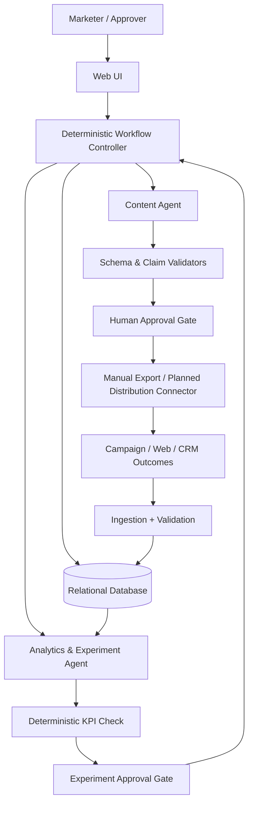

# GrowthLoop AI — Product Requirements Document

**Status:** Consolidated design — pending joint approval before implementation  
**Version:** 1.1 — 2026-10-21 (two-week implementation plan; pending joint sign-off)  
**Product:** Evidence-Driven Marketing Optimization  
**Initial design partner (hypothetical):** Nonprofit Grant Discovery and Application Readiness System  
**Implementation status:** Design only; no code, API integration, deployment, or tests completed.

## 1. Executive Summary
GrowthLoop AI is a two-agent, human-supervised marketing experimentation product. It structures marketing messages before publication (Content DNA), associates distribution and funnel outcomes with those messages, identifies evidence-supported patterns, and proposes the next controlled experiment. It is **not** a general-purpose grant research agent or a guaranteed growth engine.

The first hypothetical customer is **Nonprofit Grant Discovery and Application Readiness System** (working name: GrantReady). That customer's own product aims to use parallel evaluation and hierarchical orchestration for nonprofit grant R&D: funding research, eligibility verification, grant matching, and evidence-backed ranked opportunity reports. GrowthLoop markets that product; it does not implement its grant-research agents.

**Proposed initial wedge:** LinkedIn organic content → manual publication/export → labeled simulated engagement and demo-request metrics → evidence-based next experiment. Actual landing-page and CRM integration are post-MVP; simulated fixtures validate workflow, not market impact.

## 2. Problem Definition
### Target users
- Primary: founder, growth lead, or product marketer at a small US B2B SaaS startup without a dedicated growth analytics team.
- Secondary: content marketer or agency operator running repeated campaigns.
- First hypothetical customer: founder/marketer of GrantReady; **not** grant applicants directly.

### Problem
Teams publish many messages across channels but struggle to determine which channel, specific post, message angle, or experiment produces qualified leads. Marketing context is scattered across content drafts, social platforms, web analytics, and CRM; winning patterns are not systematically recorded and retested.

### Current workflow
Manually draft posts, publish via social tools, inspect impressions/clicks, consult web analytics and CRM, copy results to spreadsheets, and choose the next content based on intuition. This often confuses correlation with causation.

### Proposed solution
Record hypotheses and Content DNA before publication; approve content; tag links; ingest channel, website, and CRM metrics; calculate comparable funnel KPIs; distinguish observations from causal conclusions; propose controlled variants; save experiment outcomes in persistent memory.

### Business value hypotheses (not validated)
- Reduce time spent assembling campaign reports.
- Improve consistency and traceability of marketing decisions.
- Increase the share of campaigns with measurable learning and approved next experiments.
- Eventually improve qualified leads per unit of marketing effort, subject to field validation.

## 3. Goals, Non-goals, and Success Metrics
### MVP goals
1. Generate 2–3 LinkedIn draft variants from an approved GrantReady product brief.
2. Attach structured Content DNA and one primary test variable to each draft.
3. Require human approval before a draft can be marked publishable or sent to an external channel.
4. Load a clearly labeled simulated demo dataset; manual CSV upload is optional for the two-week demonstration. No real CRM is required.
5. Calculate performance by content and channel, including qualified-lead conversion, with denominators and missing-data warnings.
6. Produce a recommendation for the next experiment, its hypothesis, controlled variable, primary KPI, and stop rule.
7. Persist experiment history and show provenance and uncertainty.
8. Complete a second content-generation cycle using the approved first-cycle experiment findings, with traceable references to the saved experiment.

### Explicitly out of scope for MVP
- Building GrantReady's grant discovery, eligibility, ranking, or application workflows.
- Fully autonomous public posting, unsolicited outreach, paid advertising, budget changes, or auto-purchasing tools.
- Proving that a particular hook *caused* a sale from observational data.
- Production-grade cross-device identity resolution, multi-touch causal attribution, SEO/GEO optimization, or all-platform integrations.
- Fine-tuning, vector databases, and MCP by default.

### Proposed acceptance targets (team to approve; not measured)
| Metric | Proposed target | Measurement |
|---|---:|---|
| Structured Content DNA completeness | 100% for required fields | Schema validation |
| Content approval enforcement | 100% of attempted publish actions blocked without approval | Automated permission tests |
| Funnel math correctness | 100% on deterministic fixtures | Unit tests with known answers |
| Handoff schema compliance | ≥99% on evaluation fixtures | Contract tests |
| End-to-end task success | ≥90% across agreed fixture cases | E2E suite |
| Unsupported causal claims | 0 in approved evaluation set | Human-reviewed eval |
| End-to-end latency | Baseline first, target later | Tracing |
| Cost per completed task | Baseline first, budget cap TBD | Token/API logs |
| Human intervention rate | Track; no arbitrary target yet | Approval / escalation logs |

## 4. First Customer: GrantReady Product Context
**Positioning hypothesis:** “Find relevant nonprofit funding opportunities faster, with transparent eligibility checks and evidence-backed matching.” This is an unverified marketing claim and must be checked with the customer's actual capabilities.

**Potential buyer/user segments (to validate):** nonprofit executive directors, development directors, grant writers, and small nonprofit teams. Potential concerns: research time, missed funding opportunities, uncertain eligibility, evidence quality, and staff capacity.

**Approved claim registry is required.** Do not state that GrantReady guarantees awards, automatically submits applications, confirms eligibility without human review, or supports a data source unless the customer provides evidence.

**Sample Content DNA:**
- ICP: development director at a small US nonprofit
- Pain point: manual eligibility review consumes staff time
- Hook hypothesis: “Stop reviewing grants you cannot apply for.”
- Value proposition: evidence-backed eligibility screening and ranked opportunities
- Proof: demo walkthrough, only after product-owner approval
- CTA: request a demo
- Channel: LinkedIn
- Primary variable: hook angle (time savings vs. eligibility confidence)
- Content ID: `cnt_001`; experiment ID: `exp_001`

## 5. User Stories
- As a founder, I can submit a verified product brief and choose a target ICP.
- As a marketer, I can see each draft's claims, hypothesis, CTA, and Content DNA before approval.
- As an approver, I can reject or revise unsupported claims and prevent publication.
- As an analyst, I can import funnel results and see definitions, denominators, and data gaps.
- As a growth lead, I can see which messages correlate with qualified leads and what to test next.
- As an auditor, I can trace each recommendation to campaign data and past experiments.

## 6. MVP User Flow
1. Create workspace and product profile; upload/enter approved claims and disallowed claims.
2. Define ICP, offer, funnel events, and primary KPI.
3. Content Agent creates 2–3 drafts with Content DNA and unique IDs.
4. Deterministic quality checks run; human reviews and approves/rejects.
5. MVP: mark approved drafts as `ready_for_manual_publication`; optionally export copy and UTM links. No automatic social publishing.
6. Import labeled fixture or CSV data keyed by campaign/content/UTM IDs.
7. Analytics & Experiment Agent reads validated aggregates, computes observations, flags weak evidence, and proposes the next test.
8. Persist Experiment Memory: `experiment_id`, `content_id`, `hypothesis`, `variable`, `metrics`, `findings`, `confidence`, `next_action`, evidence and provenance.
9. Human approves the next experiment; controller passes a versioned, structured experiment brief and historical findings to Content Agent.
10. Content Agent generates the next variants linked to the preceding experiment, preserving the primary controlled variable.

## 7. Functional Requirements
| ID | Requirement | Priority | Acceptance |
|---|---|---|---|
| FR-01 | Product profile and approved claim registry | P0 | Claims editable and versioned |
| FR-02 | ICP and campaign setup | P0 | Required campaign fields validated |
| FR-03 | Draft and Content DNA generation | P0 | Each draft schema-valid |
| FR-04 | Content quality guardrails | P0 | Unsupported claims flagged |
| FR-05 | Human approval gate | P0 | Unapproved items cannot transition to publishable |
| FR-06 | UTM/content identifiers | P0 | Stable IDs attached to each draft |
| FR-07 | Load validated simulated dataset | P0 | Provenance shown, invalid records rejected; manual CSV upload is P1 |
| FR-08 | Funnel KPI calculations | P0 | Reproducible calculations, null-safe denominators |
| FR-09 | Next experiment proposal | P0 | Hypothesis, variable, KPI, controls, sample caveats |
| FR-10 | Experiment memory/history | P0 | Decisions and evidence persist |
| FR-11 | LinkedIn publishing API | P2 / Planned | Requires platform access and review |
| FR-12 | GA4/PostHog/HubSpot connectors | P1 / Planned | Each integration separately validated |
| FR-13 | SEO/GEO sources | P2 / Planned | Explicit source availability review |

## 8. Single-Agent vs Multi-Agent Decision
**Single-agent baseline:** one model receives product brief and campaign metrics, uses drafting and analytics tools, and writes recommendations. Pros: low latency/cost, simple state. Cons: mixing creative context with numerical/evidence-review context can increase prompt complexity and make separate permissions/evals harder.

**Recommended MVP: two specialist agents plus deterministic orchestration.**
- **Content Agent:** product/ICP context, approved claims, creative drafting; no write access to outcomes or publish APIs.
- **Analytics & Experiment Agent:** validated aggregate metrics and experiment history; cannot publish or change campaign outcomes; produces test proposals, not definitive causal claims.
- **Workflow controller (not an LLM agent):** validates contracts, persists records, routes jobs, enforces approvals and retries.

Split justification: **roles** (creative generation vs evidence assessment), **context** (claims and brand voice vs metric definitions and experimental history), **permissions** (draft writing vs read-only outcome analysis). If evaluation shows no measurable benefit, collapse back to one agent.

### Architecture alternatives
- **Pipeline:** chosen for MVP. Predictable Content → approval → metrics ingestion → Analytics → proposed next experiment → approval → Content. Best for traceability.
- **Coordinator:** not chosen; dynamic routing adds complexity without enough tasks to justify it.
- **Worker + Checker:** limited deterministic validators and human review are used; a third LLM checker is not justified yet.

No parallel LLM workers in GrowthLoop MVP. Parallel evaluation and hierarchical orchestration describe **GrantReady's own product**, not this marketing system.

## 9. Agent Responsibilities and Independent Loops
### Content Agent
- **Responsibility:** generate campaign drafts and Content DNA from approved inputs and experiment briefs.
- **System prompt contract:** use only approved product claims; label unverified assertions; vary only the designated experimental factor when instructed; produce structured output.
- **Observe:** approved claims, ICP, channel rules, experiment brief, relevant prior lessons.
- **Decide:** content framing, draft wording, which claim needs verification.
- **Act:** draft structured content; request clarification; propose variants.
- **Observe again:** validation errors and human feedback.
- **Tools:** read product profile, read experiment brief, structured-output model, write draft store.
- **Permissions:** read approved claims, write drafts; no public posting or CRM edits.
- **Input:** `CampaignBrief` + `ExperimentProposal` (optional).
- **Output:** `ContentDraft[]` with Content DNA, evidence references, status.
- **Handoff:** controller → approval queue → distribution/export.
- **Failure:** missing approved evidence → `needs_review`; invalid schema → bounded retry then escalation.

### Analytics & Experiment Agent
- **Responsibility:** interpret validated outcomes and propose the next controlled experiment.
- **System prompt contract:** distinguish observed association from causation; state data quality and sample limits; never fabricate metrics or claim a lift without a valid comparison.
- **Observe:** content DNA, funnel aggregates, data provenance, metric definitions, prior experiments.
- **Decide:** which hypotheses are worth testing, what uncertainty remains, which single variable to change.
- **Act:** produce structured findings and experiment proposal; request missing data.
- **Observe again:** deterministic KPI validator and human feedback.
- **Tools:** read analytics tables, calculation functions, experiment-history query, write recommendation store.
- **Permissions:** read-only raw outcomes; write recommendations only; no budget changes or posting.
- **Input:** `ValidatedPerformanceBatch` + `ContentDNA[]`.
- **Output:** `AnalysisReport` + `ExperimentProposal`.
- **Handoff:** controller → human approval → Content Agent.
- **Failure:** missing attribution → `insufficient_evidence`; zero denominator → `not_calculable`; tool failure → retry/backoff, then escalation.

## 10. Handoff Contract
All messages use versioned schemas with: `task_id`, `schema_version`, `source_agent`, `target_agent`, `status`, `result`, `evidence`, `uncertainty`, `next_action`, `error`, `created_at`.

```json
{
  "task_id": "task_20261020_001",
  "schema_version": "1.0",
  "source_agent": "analytics_experiment",
  "target_agent": "content",
  "status": "needs_human_approval",
  "result": {
    "experiment_id": "exp_002",
    "icp": "small_nonprofit_development_director",
    "channel": "linkedin",
    "hypothesis": "Eligibility-confidence messaging may generate more qualified demo requests than time-saving messaging",
    "variable_to_test": "hook_angle",
    "control": "time_saving",
    "variant": "eligibility_confidence",
    "primary_metric": "qualified_demo_requests_per_landing_page_visit",
    "constraints": ["same_offer", "same_cta", "comparable_audience"]
  },
  "evidence": [{"dataset_id":"demo_fixture_v1","content_ids":["cnt_001","cnt_002"],"source_type":"simulated"}],
  "uncertainty": {"level":"high","reason":"Simulated observational data cannot establish causal lift"},
  "next_action": "request_approval_before_generating_variants",
  "error": null,
  "created_at": "2026-10-20T18:00:00Z"
}
```

Rules: reject unknown schema versions; validate required fields and identifiers; do not silently substitute zeros for missing values; failed messages route to error queue; preserve idempotency keys and correlation IDs. A `needs_human_approval` handoff must not trigger external writes.

## 11. Data, APIs, MCP, RAG
### Data entities
- `workspaces`, `product_profiles`, `approved_claims`, `icps`, `campaigns`, `content_drafts`, `content_dna`, `approval_events`, `distribution_events`, `metric_events`, `leads` (minimal/pseudonymous), `experiments`, `recommendations`, `agent_runs`, `handoffs`, `audit_events`.
- Join keys: workspace_id, campaign_id, experiment_id, content_id, UTM campaign/content, optional consented CRM lead ID.
- Example funnel: impression → click → landing-page visit → demo request → qualified lead → customer. Distinguish post-level aggregated metrics from user-level events.

### Source status
| Source | Purpose | Status at design time |
|---|---|---|
| Approved customer brief | Claims and ICP | Required, not yet supplied |
| Local seeded fixture / CSV | Deterministic testing | Planned, under our control |
| LinkedIn metrics/publishing | Social distribution | Candidate; access, policy, quotas unverified |
| GA4 | Website events | Candidate; property/access unverified |
| PostHog | Product/landing funnel | Candidate; project/access unverified |
| HubSpot | Lead qualification/deals | Candidate; account/access unverified |
| Clay / Profound / Semrush / Blotato / Kit | Future enrichments and distribution | Optional; availability/terms unverified |

**MCP:** not required; direct APIs/functions are simpler for fixed integrations. Consider MCP only if it demonstrably reduces connector maintenance and permissions can be constrained.  
**RAG:** not required for small structured experiment memory; SQL filtering by ICP/channel/claim is sufficient. Consider retrieval over larger unstructured archives later.  
**Fine-tuning:** not required.  
**Realtime:** not required; batch sync is adequate for MVP.  
**Cleaning:** deduplicate event IDs, normalize timestamps/time zones, currency, channel labels, UTM fields, bot traffic and missing values; validate attribution windows and definitions.

## 12. Architecture and Data Flow


**Agent interaction:** Content draft → controller validates → human approves → manually distribute → outcomes ingested → Analytics proposes test → controller validates → human approves → Content receives experiment brief.

### Proposed stack (not selected/installed)
- UI: Next.js + TypeScript + Tailwind (team familiarity; simple review screens).
- API/workflow: Python FastAPI or TypeScript API; pick **one** during kickoff. Prefer deterministic state machine / queue over complex agent framework.
- Agent runtime: structured-output LLM SDK, strict JSON schema, tool allowlists; no framework required initially.
- Database: PostgreSQL in production; SQLite acceptable for local prototype if migrations preserve portability.
- Tests: pytest or Vitest, schema validation, fixture-based evals, Playwright E2E.
- Deployment: managed web hosting + managed relational DB, staging before production.
- Observability: structured trace IDs, latency/cost logs, prompt/version tracking, no raw secrets.

### Security
Least-privilege credentials; encrypted secrets; workspace isolation; RBAC for marketer/approver/admin; explicit consent for analytics/CRM data; data retention/deletion policy; audit approval and outbound actions; validate webhook signatures; rate limits; never expose API keys in client or logs. Marketing outreach and privacy obligations require legal/compliance review before production.

### Technical risks
Incomplete or misleading attribution; API access restrictions; insufficient sample sizes; platform policy violations; hallucinated product claims; experiment confounding; CRM identity mismatch; costs and latency; data leakage across workspaces.

## 13. Testing & Evaluation Plan (NOT EXECUTED)
| Layer | Test case | Expected result / pass criterion |
|---|---|---|
| Tool | Read approved claims | Only authorized workspace data returned |
| Tool | CSV contains duplicate/malformed rows | Invalid rows quarantined with reason |
| Agent / Content | Missing evidence for “guaranteed grant award” | Draft rejects or flags claim; zero unapproved guarantees |
| Agent / Analytics | 18 qualified leads / 240 clicks | Reports 7.5% leads per click with explicit denominator |
| Agent / Analytics | Low samples and confounded variants | No causal assertion; next controlled test proposed |
| Handoff | Missing `task_id` | Contract rejected and logged |
| Handoff | `needs_human_approval` status | Controller blocks publishing and next-stage execution |
| Integration | Draft → approve → import → analyze → propose | Complete trace and persistent artifacts |
| E2E | GrantReady campaign fixture | User can inspect draft, approve, import data, see justified recommendation |
| Failure | Analytics API timeout | Bounded retry, error state, no fabricated report |
| Failure | Missing CRM attribution | Mark unknown; do not assign zero sales |
| Human approval | Unapproved external publish request | 100% blocked |
| Security | Cross-workspace record access | Denied and audited |

Use a deterministic fixture suite plus human-labeled eval cases. Compare two-agent design with a single-agent baseline on output validity, factuality, latency, cost, and recovery. Do not call unrun tests passing.

## 14. Performance and Cost
Track task success, handoff success, schema errors, end-to-end latency (p50/p95), model tokens/cost per task, human intervention, retry counts, ingestion freshness, and metric completeness. Set caps for retries and per-campaign spend. Start with an explicit low-budget sandbox; monetary budgets and model selection require team confirmation. Avoid always-on agent loops: schedule or trigger runs on data availability and approval.

## 15. Risks, Assumptions, Open Decisions

### Two-week demonstration scope (joint approval required)
**P0 / Demo must work:** (1) approved hypothetical GrantReady brief and one ICP; (2) two LinkedIn draft variations with structured Content DNA; (3) human content approval; (4) deterministic load of labeled simulated metrics; (5) deterministic KPI computation with denominators; (6) Analytics & Experiment Agent proposal with caveats; (7) human experiment approval; (8) persisted Experiment Memory; (9) structured handoff back to Content Agent and generation of two Cycle 2 variants that cite the prior experiment ID; (10) reproducible automated smoke/contract tests and a runnable demo.

**P1 / Only if P0 works:** CSV upload UI, third variant, UTM export, dashboard polish, single-agent comparative evaluation, comprehensive E2E browser tests. A small single-agent baseline can be performed if time permits; the team must not claim demonstrated superiority without results.

**P2 / Not in two-week demo:** live LinkedIn publishing, CRM/GA4 integrations, paid advertising, SEO/GEO, cross-channel attribution, automated optimization or production user management.

### Hypothetical GrantReady claim policy
- Michelle is **proposed** owner of the hypothetical GrantReady brief, ICP assumptions, and claim review; Shawn is **proposed** reviewer for GrowthLoop marketing alignment. Both must confirm ownership.
- Each claim records `claim_id`, `text`, `status`, `source_or_evidence`, `reviewer`, `reviewed_at`, and `demo_only`.
- Statuses: `approved_demo_claim` (permitted only in explicitly hypothetical/demo context), `verified_claim` (supported by source evidence), `rejected_claim` (must never appear). Unreviewed claims are blocked.
- Approved demo claims are **not** represented as verified real-world capabilities. All generated demo marketing is labeled `Hypothetical product / demonstration only`.
- Any unsupported promise (grant awards, guaranteed eligibility, automated application submission) must be rejected unless independently verified and specifically approved.

### Decision register — proposed owners and relative deadlines
| Decision | Proposed lead | Approval | Target |
|---|---|---|---|
| 1. GrantReady brief and claims | Michelle | Michelle + Shawn | Week 1 Day 1 |
| 2. ICP and geography | Michelle | Both | Week 1 Day 1 |
| 3. Primary KPI / qualified demo request definition | Shawn | Both | Week 1 Day 1 |
| 4. Dataset: simulated fixture as P0; CSV as P1 | Shawn | Both | Week 1 Day 1 |
| 5. Stack, deployment, API/model budget | Shawn | Both | Week 1 Day 2 |
| 6. Content and experiment approval roles | Michelle | Both | Week 1 Day 2 |
| 7. Demo format and actual submission deadline | Both | Both | Week 1 Day 1 |

**Default technical proposal, subject to joint approval:** Next.js + TypeScript + Tailwind; Prisma ORM; local SQLite for development, managed PostgreSQL for deployment (or PostgreSQL in both environments to minimize migration risk); Anthropic API, Claude Sonnet for runtime agents, Claude Opus for architecture review; Vitest tests and Playwright smoke tests; Vercel only if database and runtime constraints are verified. Use bounded calls and a low spending cap. Never place API keys in client-side code. Avoid using ephemeral serverless SQLite files for persistent experiment memory.

### Two-cycle acceptance demonstration
1. Run Cycle 1: approved brief → two drafts with DNA → human approval → labeled simulated outcomes → deterministic KPI calculation → evidence-linked experiment recommendation.
2. Human approves recommendation; persist `experiment_id`, `source_content_ids`, hypothesis, controlled variable, metrics, caveats, reviewer, timestamp, and next action.
3. Restart/reload application; retrieve the saved experiment from the database (not model conversation memory).
4. Run Cycle 2: controller passes a schema-validated, versioned experiment brief to Content Agent; it generates two new drafts referencing the saved `experiment_id` and approved test variable.
5. PASS only if the persisted record survives reload, Cycle 2 references Cycle 1, controlled-variable changes are visible, approval gates are enforced, and simulated data is never presented as real causal proof. Log actual test outcomes; no unrun tests may be marked passing.

**Assumptions to confirm:** GrantReady owner will approve product claims; LinkedIn is first distribution channel; qualified demo request is first primary conversion; manual CSV is acceptable for MVP; the team has permission to use campaign data; the project may use a relational DB and an LLM API.

**Open decisions (must be resolved before implementation):**
1. Who owns the GrantReady product brief and approves claims?
2. Which ICP and geography should the first campaign target?
3. What exactly qualifies a lead, and what event counts as conversion?
4. Will the MVP use only simulated data, or is a real landing page/CRM available?
5. Which stack, hosting, model provider, and maximum API budget are approved?
6. Who can approve content, experiments, and eventual external publishing?
7. Is the deliverable a demo only or a live pilot, and what is the deadline?

## 16. Future Roadmap
- **M0 — Design approval:** resolve decisions, freeze metric definitions, approve schemas.
- **M1 — Demo loop:** campaign brief, Content DNA, review, fixture import, validated analytics, experiment proposals, audit history.
- **M2 — Real pilot:** landing page + GA4/PostHog + CRM integration, consent and privacy review, real A/B test.
- **M3 — Distribution:** approved LinkedIn publishing and scheduled sync if permitted.
- **M4 — Multi-channel:** email, SEO/GEO, additional social, cross-channel attribution caveats.
- **M5 — Advanced optimization:** statistical experiment planning, adaptive allocation only with guardrails, stronger causal inference, optional retrieval.

## 17. Two-Week Delivery Plan and GitHub Issues
**Ownership is a proposal pending Michelle and Shawn's agreement.** Track implementation work in `TEAM_TASKS.md`; issue URLs and actual status in GitHub are authoritative. Prioritize the vertical slice and two-cycle demo over feature breadth.

**Week 1:** Day 1 sign off brief, ICP, KPI, claims, demo deadline; Day 2 freeze schemas, stack and permissions; Days 3–4 connect app, database, Content Agent and approvals; Days 5–7 load fixture, calculate KPIs, implement Analytics Agent and structured handoff. Week 1 exit: at least one cycle works locally.

**Week 2:** Days 8–9 persist Experiment Memory and generate Cycle 2; Days 10–11 add tests and repair failures; Days 12–13 verify deployment, record demo, prepare submission; Day 14 buffer and final review. Week 2 exit: repeatable two-cycle demo with logs and approved claims.

### Original detailed backlog (re-prioritize against Week 1 / Week 2)
| Issue | Title | Dependencies | Definition of done |
|---|---|---|---|
| #1 | Confirm product brief, ICP, KPI, approvals | None | Decision log approved |
| #2 | Define schemas and sample data contracts | #1 | JSON schemas + example valid/invalid payloads |
| #3 | Build database schema and migrations | #2 | Local migrations + workspace isolation tests |
| #4 | Create product profile and campaign UI | #3 | Save/edit approved claims and ICP |
| #5 | Implement Content Agent structured drafting | #2,#4 | 3 valid drafts with DNA; claim safety eval |
| #6 | Implement review/approval state machine | #5 | Unapproved outbound action blocked |
| #7 | Implement UTM builder and export | #6 | Stable IDs and valid tagged URLs |
| #8 | Implement fixture/CSV ingestion | #2,#3 | Clean, reject, audit malformed rows |
| #9 | Implement deterministic funnel metrics | #8 | Exact expected results on fixtures |
| #10 | Implement Analytics & Experiment Agent | #9 | Evidence-linked proposals; no causal overclaim |
| #11 | Implement handoff and retry controller | #5,#10 | Contract/error/approval tests pass |
| #12 | Build performance + experiment history UI | #9,#10 | Inspect metrics, provenance, decisions |
| #13 | Run E2E, failure, security and cost evals | #11,#12 | Published test report with actual results |
| #14 | Pilot real integrations after approval | #13 | API access and privacy reviewed; pilot tracked |

**No implementation work should begin before PRD and architecture approval.** Planning and account/API readiness checks are allowed before approval; avoid provisioning costly services without agreement.
