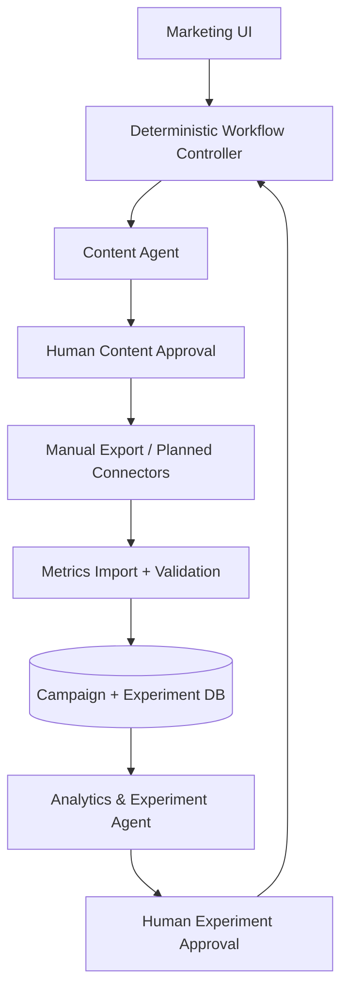

# GrowthLoop AI

**Evidence-Driven Marketing Optimization — Final design draft, proposed 2-Agent MVP**

> **Project status: PLANNED / DESIGN ONLY.** No application code, agents, integrations, tests, or deployment have been implemented. This README describes the intended project, not an existing working application.

## Project Overview
GrowthLoop AI helps early-stage B2B SaaS teams turn marketing campaigns into measurable experiments. It records the hypothesis and structured **Content DNA** of each post before distribution, connects post-level performance to website and CRM funnel outcomes, and recommends the next controlled test.

**Initial hypothetical customer:** *Nonprofit Grant Discovery and Application Readiness System* (working name: GrantReady), a separate proposed multi-agent nonprofit grant R&D product that would research funding, verify eligibility, match opportunities, and create evidence-backed ranked opportunity reports. **GrowthLoop markets GrantReady; it does not build or operate GrantReady's grant agents.**

## Problem & Solution
**Problem:** Teams can generate and publish content but struggle to learn which message, channel, or post brings qualified leads and why. Data and campaign hypotheses are disconnected.

**Solution:** A human-approved loop: product brief → structured drafts → content review → tagged distribution/manual export → metric ingestion → evidence-aware analysis → next experiment proposal → approval → new drafts.

Observational results support hypotheses, not proof that a particular hook caused a sale. Simulated data cannot demonstrate actual marketing lift.

## Key Features — All Planned
- **Planned:** Campaign setup, ICP, approved claims, and brand constraints.
- **Planned:** Content Agent generating 2–3 LinkedIn variants with Content DNA.
- **Planned:** Content review/approval gate and UTM/content identifiers.
- **Planned:** Simulated dataset and manual CSV ingestion with source labeling.
- **Planned:** Funnel dashboard for clicks, visits, demo requests, qualified leads, and conversions.
- **Planned:** Analytics & Experiment Agent generating evidence-linked next-test proposals.
- **Planned:** Persistent experiment memory (`experiment_id`, `content_id`, hypothesis, variable, metrics, findings, confidence, next action), audit trail, errors, and uncertainty.
- **Planned:** Structured Analytics → approval → Content handoff; next-round variants link back to the prior experiment.
- **Planned:** Data provenance labels (`simulated`, `manual_import`, `live`) and validation status; simulated results never count as real-world lift.
- **Later:** LinkedIn publishing, GA4/PostHog/HubSpot connectors, SEO/GEO and multi-channel attribution.

## Architecture Overview — Proposed


**Why two agents?** Content creation and metric interpretation require different context, evaluations, and permissions. A single-agent baseline must also be tested; multi-agent complexity is justified only if quality/maintainability improves. The workflow controller is **not** a third LLM agent.

## Agent Roles
| Agent | Reads | Writes | Cannot do |
|---|---|---|---|
| Content Agent | Approved claims, ICP, experiment brief | Drafts + Content DNA | Public posting, CRM modification |
| Analytics & Experiment Agent | Validated metrics, Content DNA, experiment history | Analysis + next-test proposal | Change source metrics, publish, spend budget |

Both follow Observe → Decide → Act → Observe with structured JSON handoffs. Controller handles schema validation, retries, state transitions, and approvals. See [GrowthLoop_AI_PRD_Final.md](GrowthLoop_AI_PRD_Final.md) for contracts and detailed architecture.

## Proposed Tech Stack (not installed)
- Frontend: Next.js / TypeScript / Tailwind.
- Backend: choose FastAPI **or** TypeScript API at kickoff; not both by default.
- Database: PostgreSQL; SQLite acceptable for local demo.
- Agents: LLM structured output with schema validation and allowlisted tools; framework optional.
- Testing: pytest or Vitest; Playwright for E2E.
- Hosting: TBD after team approval.

**MCP:** not required for MVP. **RAG/vector DB:** not required for small structured experiment history. **Fine-tuning:** not required. Use direct functions/APIs and relational queries first.

## Prerequisites — Planned
- Approved PRD, GrantReady claims/ICP, conversion definition, model/provider budget.
- Node.js and package manager if Next.js is selected; Python only if FastAPI is selected.
- Local database or approved managed PostgreSQL instance.
- LLM provider key for live model testing; deterministic fixtures for non-model tests.
- API access only for integrations explicitly approved by the team.

## Installation — Not Yet Available
No repository implementation or installable dependencies exist yet. **Do not run commands from an invented package structure.** After stack approval and issue implementation, this section will contain exact verified commands and versions.

## Environment Variables — Proposed Names Only
```dotenv
DATABASE_URL=
LLM_API_KEY=
LLM_MODEL=
APP_BASE_URL=
SESSION_SECRET=
# Optional future integrations — not needed for local demo
LINKEDIN_ACCESS_TOKEN=
GA4_PROPERTY_ID=
GOOGLE_APPLICATION_CREDENTIALS=
POSTHOG_API_KEY=
HUBSPOT_ACCESS_TOKEN=
```
Names are provisional. Never commit actual values. Use `.env.example` with blank placeholders when implementation begins.

## How to Run — Not Yet Available
There is no runnable app. Planned local demo path after implementation:
1. Seed an explicitly labeled **simulated** GrantReady campaign dataset.
2. Enter approved product brief, ICP, and success metric.
3. Generate and review content variants and Content DNA.
4. Approve drafts and export tagged links for manual distribution.
5. Import simulated outcomes or consented CSV metrics.
6. Inspect KPI calculations, evidence, uncertainty, and next experiment.
7. Approve the next experiment to regenerate controlled variants.

## How to Test — Planned, Not Executed
- Unit: funnel formulas, zero denominators, deduplication, UTM IDs.
- Agent: approved-claims compliance, structured Content DNA, evidence-aware recommendations.
- Contract: required handoff fields, unknown schema versions, missing IDs, failure statuses.
- Integration: two agents coordinated through persisted workflow state.
- E2E: GrantReady example from brief to next experiment.
- Failure: missing CRM data, bad CSV, API timeouts, duplicate events.
- Approval: block all unapproved external publishing or spending.
- Security: workspace separation and secret redaction.

No tests have run and no pass rates are claimed. Test cases and proposed success criteria are specified in [GrowthLoop_AI_PRD_Final.md](GrowthLoop_AI_PRD_Final.md).

## Project Structure — Proposed, Not Created
```text
growthloop-ai/
  PRD.md
  README.md
  docs/
    decisions.md
    data-dictionary.md
    evaluation-plan.md
  apps/
    web/                 # Planned frontend
  services/
    api/                 # Planned backend/controller
  agents/
    content/             # Planned Content Agent
    analytics_experiment/# Planned Analytics & Experiment Agent
  schemas/               # Planned contracts
  data/
    fixtures/            # Explicitly simulated datasets
  tests/
    unit/
    contract/
    integration/
    e2e/
```

## Known Limitations
- No verified live APIs, campaign data, or paying customers.
- Initial content is for LinkedIn; publishing is manual in MVP.
- Historical/observational data cannot isolate causal impact without experimental controls.
- Sparse samples, attribution loss, delayed sales, and platform privacy constraints can limit conclusions.
- Automated outreach and budget optimization are outside MVP.

## Security Notes
Enforce least privilege, workspace isolation, server-side secrets, human approval for external writes, source provenance, retention/deletion policies, and privacy review for user/CRM data. Never place tokens, personal information, or raw secrets in logs or example fixtures. Respect platform automation policies and applicable marketing/privacy rules.

## Future Improvements
1. Live GA4/PostHog/HubSpot data with validated mappings.
2. Approved LinkedIn publishing and scheduled sync.
3. More channels: email, SEO, GEO, paid campaigns.
4. Stronger A/B test design, statistical guardrails, uncertainty calibration.
5. Better experiment memory and retrieval once corpus size justifies it.
6. Optional additional agents only if evaluation shows clear benefit.

## Collaboration and Development Roadmap
See **GrowthLoop_AI_PRD_Final.md §17** for 14 proposed GitHub Issues, dependencies, and definitions of done. Issues have **not** been created on GitHub.

**Approval gate:** do not start coding, install dependencies, or create agents until the team approves the PRD, architecture, conversion metric, data assumptions, and stack.
