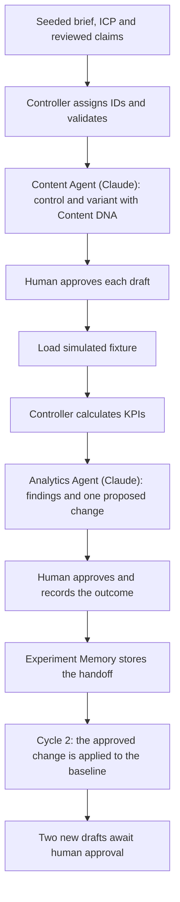

# GrowthLoop AI

**A human-supervised, two-agent marketing experiment demo by Michelle Sainsbury and Shawn Bi (Pursuit Level 2).**

GrowthLoop AI helps an early-stage B2B team learn from LinkedIn messaging experiments. A **Content Agent** writes two post variants, a human approves them, simulated results become deterministic KPIs, an **Analytics & Experiment Agent** proposes one change, a human approves it, and the findings feed the next cycle.

**The demo customer is GrantReady, a hypothetical nonprofit grant discovery and application-readiness concept.** GrowthLoop AI markets it; it doesn't build grant features. All outcomes are pre-authored simulated data, not campaign results, and nothing is published.

## Status

Everything below is on branch `feature/grantready-demo`, which stacks on PRs #5–#19. **`main` has only the foundation and the KPI work**; the `main` ruleset needs one approval before the rest can land.

| Area | Status |
|---|---|
| Analytics Agent, KPIs, Neon persistence, access protection, deployment | Tested with real Claude and Neon on Vercel previews |
| Content Agent (Cycle 1 drafts with real Claude) | Built; real-model smoke passes for all five test variables |
| GrantReady brief, ICP, claims, banned phrases | Hypothetical demo wording, reviewed by Shawn only |
| Michelle's independent review | Covers commits up to PR #17. **The fixes in PR #19 and everything on this branch have not been independently reviewed** |
| Two-cycle run on a preview | See [the test report](docs/test-report.md) |

See [Known limitations](#known-limitations) before relying on any of this.

## How the loop works



- **Content Agent** (`lib/agents/content`): one structured Claude call in Cycle 1. It returns the control plus one replacement value, so the pair can only differ in the tested dimension. It must repeat each approved claim word for word, and one repair attempt is allowed.
- **Analytics Agent** (`lib/agents/analytics`): receives stored metrics and Content DNA, cites metric IDs, states its uncertainty and proposes exactly one change. It does no arithmetic.
- **Controller** (`lib/controller`): plain TypeScript. It owns IDs, state transitions, KPI math and validation, and calls the agents. Agents have no tools and no database access.
- **Cycle 2 makes no model call for copy.** It applies the exact replacement the human approved to the baseline, so what was approved is what appears.

## Safeguards

- **Human gates:** each draft and each proposal needs a human decision, and every decision is an audit event.
- **Claims:** only `approved_demo_claim` or `verified_claim` IDs can be used, and they are re-checked at generation, approve, `mark_ready` and analysis.
- **Banned content:** banned phrases and rejected-claim wording are refused at generation, approve and `mark_ready`, and in the proposed replacement. These checks are incomplete, so a human still decides.
- **Evidence:** a proposal citing an unknown metric or changing more than one variable is an error and can't be approved.
- **Failures are visible:** refusals, truncation and invalid output return an error and leave no drafts or proposal. There is no template fallback.
- **Cost:** 30 successful model calls per UTC day, failures excluded.

## Run it

Needs Node 24 and a Neon database. Copy `.env.example` to `.env.local` and fill it in.

```bash
npm ci
npm run db:migrate
npm run db:seed
npm run dev
```

Open <http://localhost:3000>, enter `DEMO_ACCESS_CODE`, and follow the page from Start Cycle 1. To start the demo again from `exp_001`, run:

```bash
npm run demo:reset -- --yes
```

## Test it

```bash
npm test
npm run typecheck
npm run lint
```

`npm test` makes no paid calls: the database is PGlite and only the Anthropic transport is replaced. These checks call real services:

| Command | Checks | Needs |
|---|---|---|
| `npm run smoke:anthropic` | Analytics Agent with real Claude | `.env.local` |
| `npm run smoke:content` | Content Agent with real Claude, all five variables | `.env.local` |
| `npm run smoke:deploy` and `smoke:deploy:write`, `:read`, `:cleanup` | Deployed preview, seeded test data | `PREVIEW_URL` |
| `npm run smoke:e2e` | Both cycles through a preview, on the seeded claims | `PREVIEW_URL`, no `exp_001` |

## Known limitations

- **Reviewer roles are labels**, recorded for audit. The shared access code doesn't identify a person, and this isn't RBAC.
- **Claim history:** status, reviewer and date keep only the latest value. Claim text and evidence can't be changed.
- **Content revisions:** the revision loop in `lib/content-agent/revision-loop.ts` is in Michelle's standalone Content Studio, not the integrated app. A rejected draft here can't be regenerated without resetting the demo.
- **Direct Content calls:** `generatePosts` in `lib/content-agent` trusts the claim text it's given and isn't reachable from any route. The controller is the enforced boundary.
- **One campaign:** Cycle 1 is always `exp_001`, and the demo stops at two cycles (`MAX_EXPERIMENT_CYCLES`).
- **KPIs prove nothing about marketing.** They are simulated and carry no causal or statistical meaning.

## Who built what

| | Contribution |
|---|---|
| Michelle Sainsbury | Content generator, revision and dashboard work, Content DNA and handoff 1.1 contract, Content integration, GL-03 fixture and independent expected KPIs, independent review of PRs #4–#17, and the separate [Content Studio](https://github.com/Michelle-Sainsbury/GrowthLoop-Content-Studio) |
| Shawn Bi | Analytics Agent, KPI code, controller and API, persistence, access protection, deployment, the fixes for review findings, and the GrantReady seed data and Claude-backed Content Agent on this branch |

## Documents

- [PRD](PRD.md) and [team tasks](TEAM_TASKS.md): requirements and the GL-01–GL-12 plan.
- [Decision log](docs/decisions.md): draft, not signed.
- [Test report](docs/test-report.md): actual results only.
- [Integration notes](docs/content-integration.md) and [demo script](docs/demo-script.md).
