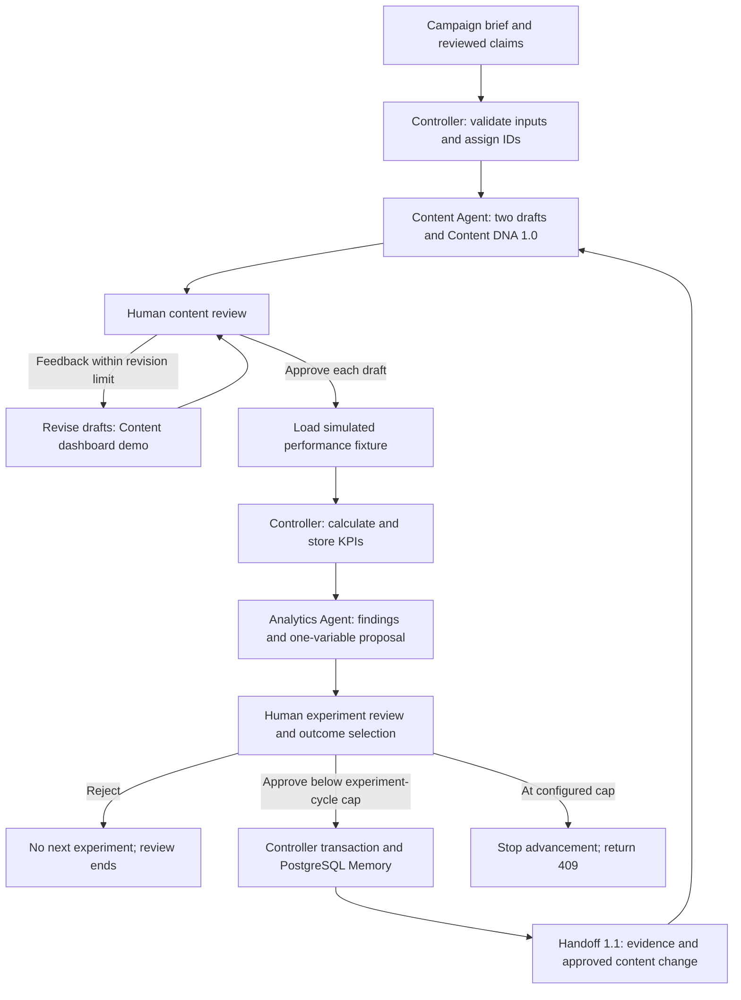

# GrowthLoop AI

**A shared, human-guided content and analytics project by Michelle Sainsbury and Shawn Bi.**

**Progress snapshot: October 29, 2026 · Pursuit Level 2, Lesson 7 README**

This is the shared repository designated for the Pursuit Level 2 Lesson 7 submission. It documents both agents, their handoffs, and their shared state. Michelle's separately deployed [Content Studio](#supplementary-content-studio-demo) is supplementary demonstration material, not a replacement for this repository or proof of live two-agent integration.

## Purpose and scope

GrowthLoop AI helps a founder or marketer connect a messaging experiment to a clear next step: prepare two LinkedIn drafts, review them, inspect simulated performance, and approve one controlled change for the next experiment.

The demonstration customer is **GrantReady**, a hypothetical nonprofit grant-discovery and application-readiness product. GrowthLoop AI markets that hypothetical product; it does not implement grant search, matching, eligibility checks, or applications. Product claims require reviewed evidence or clear hypothetical labeling.

The intended system has two specialized agent roles coordinated by TypeScript, with PostgreSQL Experiment Memory and human approval gates. **The implemented Content path currently generates text deterministically in TypeScript; the Analytics adapter calls Anthropic. Genuine Anthropic-backed Content generation and the complete live two-agent workflow are not independently verified.**

The demonstration uses one campaign, one audience, LinkedIn organic content, and two drafts per experiment. It does not publish content, connect to live LinkedIn/CRM/GA4, establish marketing effectiveness, prove causal lift, or demonstrate that multiple agents outperform one. Accounts/RBAC, multi-workspace support, CSV upload, and a third variant remain outside the core demonstration.

## What is actually on main?

As inspected on October 29, remote main is [42fd614](https://github.com/Shawn-Bi/GrowthLoop-AI/commit/42fd6143c7aa358742b56234427c41d8c07ec6f6), containing the early Content dashboard from PR #2 and dependency/environment scaffolding from PR #3.

| Location | Implemented there | Status relative to main |
|---|---|---|
| main | Next.js/React dashboard; deterministic A/B templates; browser-state feedback/history; explicit approval action; three total Content revision cycles; Node 24 and pinned starter dependencies | Merged. No Analytics adapter, controller APIs, Prisma schema, persisted Experiment Memory, versioned DNA/handoff schemas, or automated test scripts in this snapshot |
| [PR #13](https://github.com/Shawn-Bi/GrowthLoop-AI/pull/13), feature/content-agent; feature/content-dna; feature/content-integration | Additional Content behavior and contracts developed beyond the early dashboard | Separate branches; do not assume main includes them |
| test/content-agent-ab-contract at [2d34da0](https://github.com/Shawn-Bi/GrowthLoop-AI/commit/2d34da015610c6ff2630001b1ce584fba506fadd), and integration/content-analytics-loop at [4979786](https://github.com/Shawn-Bi/GrowthLoop-AI/commit/49797865ac3900834846cc4aaf8ec467cd2a2053) | Content A/B/claim safeguards and controller-to-Content integration work | Separate development/integration history, not a main release |
| [PR #5](https://github.com/Shawn-Bi/GrowthLoop-AI/pull/5), [PR #6](https://github.com/Shawn-Bi/GrowthLoop-AI/pull/6), [PR #7](https://github.com/Shawn-Bi/GrowthLoop-AI/pull/7), [PR #11](https://github.com/Shawn-Bi/GrowthLoop-AI/pull/11) | Analytics, persistence, controller APIs, and registry seeding/retirement | Implemented on the feature stack, not merged into this main snapshot |
| [PR #12](https://github.com/Shawn-Bi/GrowthLoop-AI/pull/12), [PR #16](https://github.com/Shawn-Bi/GrowthLoop-AI/pull/16), [PR #17](https://github.com/Shawn-Bi/GrowthLoop-AI/pull/17) | Persisted Content drafts/approval; handoff 1.1; human-selected baseline and configurable experiment-cycle cap | Feature-branch implementation with local verification and remaining integration issues |
| [PR #15](https://github.com/Shawn-Bi/GrowthLoop-AI/pull/15), incorporated into [PR #4](https://github.com/Shawn-Bi/GrowthLoop-AI/pull/4) at 5270d79 | Michelle's approved GL-03 simulated fixture and independent KPI expectations with the KPI implementation | Merged into the KPI stack; not into this main snapshot |

**Main provides the basic browser-state Content dashboard. The fuller Content-to-Analytics-to-Content integration is implemented on separate PR branches and is not available by checking out main alone.** The architecture and workflow below describe those integration branches; implementation there does not establish complete live verification. Branches can advance; test results apply only to the exact commits recorded below, not automatically to their latest heads.

## Both agents and the controller

| Component | Responsibility | Implementation and boundary |
|---|---|---|
| Michelle's Content Agent | Validate a brief, produce control/variant LinkedIn drafts, carry approved claim references and Content DNA, support review/refinement, and apply the approved next-cycle edit | TypeScript generation in lib/content-agent. The early dashboard uses reviewer-supplied claim text; integrated branches add registry-ID validation. Neither should be described as an independent fact-check |
| Shawn's Analytics & Experiment Agent | Receive stored draft DNA and precomputed KPIs; return findings, metric citations, uncertainty, and a proposed single-variable experiment | Server-side Anthropic adapter in lib/agents/analytics. It recommends; it does not approve, publish, calculate the authoritative KPIs, or directly write the database |
| Shared TypeScript controller | Assign IDs, ingest/validate fixtures, calculate KPIs, invoke agents, validate outputs, enforce transitions, and coordinate database writes | lib/controller and protected API routes on the integration stack. It connects approved recommendations to the next Content pair |
| Experiment Memory | Retain the experiment chain, drafts, claims, metrics, recommendations, approvals, and handoff evidence | Neon PostgreSQL with Prisma; disposable PostgreSQL is used for local tests |

Integration is shared engineering work. Agents receive structured inputs rather than database credentials or tools for direct database access.

## Workflow and feedback

This diagram shows the integration workflow and approval boundaries; it is not a claim that every path has passed live deployment testing.



The inner feedback/revision path is a browser-state Content demonstration, not evidence of a persisted server-side revision endpoint.

Two different limits must not be confused:

- **Content revision loop:** three total cycles, including initial generation plus up to two revisions. In the Content dashboard/Studio, approving a draft ends that revision loop; it does not automatically start another revision or publish.
- **Experiment loop on PR #17:** MAX_EXPERIMENT_CYCLES defaults to 2. An explicit configuration of 3 permits a third experiment. The human records control_better, variant_better, or inconclusive. Only variant_better moves the baseline to the prior variant; the other outcomes retain control. If a primary KPI is not calculable, neither winner choice is allowed. At the cap, advancement returns 409. Rejecting a proposal ends that review but leaves the experiment open.

The demonstration normally ends after Cycle 2 draft generation/optional approval. A second metrics analysis is not required for the two-cycle demonstration.

## Content DNA 1.0 and Handoff 1.1

Content DNA is a structured description of the actual post, rather than an unexplained text blob. Its schema and the handoff schema have **different version numbers**.

| Content DNA 1.0 field | Meaning |
|---|---|
| schema_version | Literal "1.0" |
| icp | Intended customer/audience as a nonempty string |
| pain_point, hook, value_proposition, evidence, cta | Nonempty text describing the five content dimensions; these also form the generated post |
| channel | linkedin_organic |
| primary_test_variable | Exactly one of pain_point, hook, value_proposition, evidence, cta |
| variant_role | control or variant |
| claim_ids_used | Registry claim IDs used by that draft |
| brief | audience, campaignGoal, keyMessage |
| generation_context | Experiment/parent/correlation identifiers, approved findings and supporting metric IDs, and approval state |

The valid generator preserves baseline dimensions and replaces only the approved dimension in the variant. That does not imply every corrupted stored DNA record is rejected; see the outstanding issues below.

Handoff 1.1 carries:

- schema_version, task_id, correlation_id, idempotency_key;
- experiment_id and parent_experiment_id, plus source_content_ids and approved_claim_ids;
- hypothesis, primary_test_variable and control_conditions;
- findings, metric_ids and uncertainty;
- approval_state and next_action;
- **content_change**, required when a parent exists: baseline_content_id identifies a source draft, and variant_value supplies the approved replacement text.

The controller and Content code both parse the shared contract. Supported versions and required fields are checked; the controller adds database/proposal/evidence checks. In a valid Cycle 2 handoff, findings, supporting metric IDs, approved claims, and experiment/correlation IDs are retained in the generated drafts' context. Findings justify the proposed edit; the generator applies the concrete approved replacement rather than independently reasoning over the findings.

Pinned schema references: [Content DNA](https://github.com/Shawn-Bi/GrowthLoop-AI/blob/c9320973263be7b4dc850869b649fca507f5780f/schemas/content.ts) and [Handoff](https://github.com/Shawn-Bi/GrowthLoop-AI/blob/c9320973263be7b4dc850869b649fca507f5780f/schemas/handoff.ts).

## Experiment Memory and shared state

The integrated Prisma model stores:

| Record | Shared state it preserves |
|---|---|
| Experiment | Hypothesis, selected variable, cycle, status, correlation ID, parent/child association |
| ContentDraft | Body, role, experiment association, claim IDs, Content DNA, approval status |
| Claim | Registry version, text, evidence, reviewer metadata and usability status |
| MetricRecord | Dataset provenance, draft/experiment association, deterministic metric ID, numerator/denominator and calculation status |
| AnalysisReport | Findings, recommendation, review errors/flags, decision and human-selected outcome |
| Handoff | The approved, versioned instruction connecting parent evidence to the next experiment |
| AuditEvent and AgentRun | Successful decision records and agent execution metadata; role labels are not identity proof |

A PostgreSQL-backed quota table supports the Analytics generation limit. SQL transactions, conditional updates and unique keys protect normal approvals from duplicate or partial writes. Local tests verify persistence and rollback using PGlite, a disposable PostgreSQL engine. This is not proof of live Neon migrations, credentials, deployed durability, or protection against every invalid stored record.

The main dashboard and independent Studio instead keep their demonstration state in browser memory; refresh clears it. They do not themselves provide database-backed Experiment Memory.

## Human approval, claims and simulated KPIs

The integrated workflow requires explicit review of each Content draft and approval of the Analytics recommendation before a next experiment. Claims use approved_demo_claim, verified_claim, or rejected_claim; missing/unreviewed IDs are prohibited. Approved hypothetical claims require visible demonstration labeling. Revocation is represented by rejection, and later integrated paths recheck claims at approval and mark_ready.

ready_for_manual_publication is a review state, not a publishing action. **Nothing automatically posts to LinkedIn.** A server-validated shared access code protects the integration APIs, but request-supplied content_reviewer and experiment_approver labels do not authenticate Michelle or Shawn.

Michelle's GL-03 values are **simulated, pre-authored data**, not actual campaign results and not caused by the generated drafts:

| Role | Primary: qualified requests / visits | Secondary: qualified requests / clicks |
|---|---|---|
| Control | 8 / 80 = 10% | 8 / 100 = 8% |
| Variant | 15 / 100 = 15% | 15 / 120 = 12.5% |

Invalid rows are quarantined with reasons. Zero denominators produce not_calculable, never a fabricated 0%. Missing or malformed rows are rejected/quarantined rather than silently converted to zero. The approved fixture and independent expectations must not be replaced with a different smoke fixture.

## Implementation versus verification

Independent local reviews recorded these full-suite passes at exact historical commits:

| PR / component | Tested commit | Committed Vitest tests passed |
|---|---|---|
| #5 Analytics | a800561 | 76 |
| #6 persistence | 7773e8a | 99 |
| #7 controller | 1e3c2f0 | 143 |
| #11 claims | 4f6a76f | 153 |
| #12 draft approval | b69b7c4 | 223 |
| #16 handoff 1.1 | 48a68ea | 229 |
| #17 baseline and limits | c932097 | 247 |

These are overlapping branch suites, not counts to add together. Their passing committed tests had no skipped cases. At PR #17's tested commit, npm test and npm run test each passed the same 247 tests; TypeScript and lint passed, and the additional Content command passed 15 tests. The KPI suite's 38 tests include 12 GL-03-specific tests.

Independent supplemental checks at that PR #17 commit ran outside the repository: **145 checks, 127 passes, 18 failed safeguard expectations, zero skipped**. They include inherited defects, repeated manifestations, stronger boundary expectations and a documented identity limitation, not 18 newly introduced PR #17 regressions. These temporary probes are not part of npm test and are not published here as a committed test suite.

Local integration used production handlers and actual Content/Analytics parsing code with disposable PostgreSQL and **stubbed Anthropic transport**. It verified valid handoff preservation, outcome selection, configured cycle caps, claim rechecks and normal transaction rollback, including failure during the second child-draft insert. Those tests do not establish genuine model output or production integration.

Installation caveat: clean npm ci attempts failed at Prisma's native-engine checksum download with HTTP 403. Reviewers generated the ignored client with official version-matched Prisma 7.10.1 in-process tooling to continue testing; clean installation itself was not reported as passed. No checksum protection was disabled.

**Newer source is not automatically reverified:** PR #12 has advanced to 9de2c9c and PR #16 to a8564cc. Their source removes the conditional child-generation guard and adds regression tests, but those heads have not been independently executed in this README update. PR #17 remains at the tested c932097 snapshot with the reproduced defect. No application tests or build were rerun for this documentation-only edit.

Shawn's historical live smoke reports are author-reported, dated evidence for particular environments/commits. They are distinct from the independent local reviews. A complete live Anthropic/Content/Neon/browser two-agent workflow has not been independently verified.

## Known Limitations and Outstanding Integration Issues

### Reproducible defects at the tested integration commits

- **Critical missing Content DNA/schema-version check:** at PR #17 c932097, removing the first source draft's schema_version or replacing its DNA with an empty object can return HTTP 200, approve the proposal, and create a child experiment/handoff with **zero generated child drafts**. Unsupported versions with the key present return 409 and roll back. A corrupt unselected first control can also skip generation for a valid selected variant. The newer #12/#16 change needs independent regression verification and propagation into the relevant integration branch; it is not a verified fix on #17 or main.
- **DNA consistency and identifiers:** duplicate claim IDs can conceal an omitted claim; incorrect stored experiment/correlation identifiers and DNA/body disagreement can pass some approval/advancement paths. Shape validation is not relational or provenance validation.
- **Banned phrases:** enforcement is not fully implemented. Supplemental testing allowed an unverified grant-award guarantee to reach manual-ready while legitimate claim text was also present.
- **Historical claims:** removing a registry entry preserves its row and marks it rejected, but reseeding an existing ID can overwrite the text/evidence/reviewer metadata referenced by historical drafts.
- **Metadata and contract boundaries:** whitespace claim metadata and some metadata corruption are insufficiently checked. Unknown handoff fields are stripped. Direct Content calls rely on controller checks for some metric-reference and baseline-provenance validation.

### Documented limitations and outstanding verification

- Reviewer-role labels are request supplied, not verified identities or RBAC. An approval event does not prove the designated person made it.
- Final reviewed GrantReady brief, ICP, claims, banned phrases and example inputs remain pending where absent. The reviewed integration snapshot has no approved data/seed/claims.json; test claims are synthetic substitutes, not approved customer inputs.
- Genuine Anthropic-backed Content generation remains unverified; the exercised Content path uses deterministic TypeScript. Meeting the PRD's two-LLM requirement or changing that scope needs explicit agreement.
- Live Neon migration/persistence, genuine two-agent model calls and a complete deployed browser workflow require separate evidence. Credentials were unavailable for independent verification; no live database was changed.
- The original $50 spend-limit requirement and the proposed school-key exception need explicit reconciliation. A daily call-count limit does not guarantee a dollar budget.
- Official course submission details beyond the confirmed shared README, remaining acceptance decisions and final joint sign-off must be recorded explicitly. Implementation, test review or a supplementary deployment does not imply either collaborator's release approval.

These issues are disclosed, not fixed by this README. Broader commercial claims, production readiness and real marketing lift remain unvalidated.

## Run the main-branch dashboard

Use Node.js 24 and the committed lockfile:

```bash
git clone https://github.com/Shawn-Bi/GrowthLoop-AI.git
cd GrowthLoop-AI
git switch main
npm ci
npm run dev
```

Open the local URL printed by Next.js, normally http://localhost:3000. This starts the early Content dashboard, not the unmerged Analytics/controller workflow. Its deterministic browser-state demo needs no Anthropic or database credentials.

Available main scripts are npm run dev, npm run build, npm start and npm run lint. npm start requires a completed production build. Main does **not** define npm test, npm run typecheck, db:migrate or integration smoke scripts at the inspected snapshot. These instructions describe the checked package scripts; they were not freshly executed for this README edit.

## Configure and test an integration checkout

Use an isolated checkout of the intended, explicitly reviewed integration commit; do not merge feature branches merely to follow this README. The [package scripts at the tested PR #17 snapshot](https://github.com/Shawn-Bi/GrowthLoop-AI/blob/c9320973263be7b4dc850869b649fca507f5780f/package.json) and its [.env.example](https://github.com/Shawn-Bi/GrowthLoop-AI/blob/c9320973263be7b4dc850869b649fca507f5780f/.env.example) are the references.

Copy .env.example to an ignored .env.local and supply authorized development values privately. Never commit or publish credentials.

| Variable name | Purpose |
|---|---|
| ANTHROPIC_API_KEY | Server-only Analytics API credential |
| ANTHROPIC_MODEL | Account-accessible model ID; verify access rather than assuming a model is available |
| DATABASE_URL | Pooled Neon runtime connection |
| DATABASE_URL_UNPOOLED | Direct migration/seed connection |
| DEMO_ACCESS_CODE | Shared demonstration access gate |
| MAX_EXPERIMENT_CYCLES | Optional experiment-chain cap on PR #17; default 2 |
| PREVIEW_URL | Optional target for explicit deployment smoke checks |
| VERCEL_AUTOMATION_BYPASS_SECRET | Optional automation bypass for protected previews |

There is no required SESSION_SECRET in this demo. Do not expose API/database credentials through NEXT_PUBLIC variables. Keep server-only integrations on the server.

On the integration snapshot, these scripts exist:

```bash
npm ci
npm test
npm run test:content
npm run test:integration
npm run typecheck
npm run lint
npm run build
```

npm test and the local integration suite use mocked model transport, not paid live calls. A successful test suite is not a successful production build. Prisma downloads and Next.js build-time font downloads can be blocked by the environment; report such failures rather than claiming a clean build.

Database preparation uses npm run db:migrate and npm run db:seed. These write to the configured database: use an authorized disposable development database, not shared/live credentials. Seeding requires the reviewed registry file; it cannot complete from absent final inputs. It supports an explicit registry-file argument.

Separate live smoke scripts include npm run smoke:anthropic, smoke:db:write/read/cleanup and smoke:deploy variants. Read package.json for the exact individual names. They need credentials, can incur API costs or mutate data, and are not automatic acceptance checks to run against a shared database. None were invoked for this README edit.

## Supplementary Content Studio demo

- [Michelle's independent GitHub repository](https://github.com/Michelle-Sainsbury/GrowthLoop-Content-Studio)
- [Separately deployed Content Studio](https://growthloop-content-studio.vercel.app)

This is a deterministic TypeScript/Next.js Content Studio with an animated feedback diagram, A/B LinkedIn previews, human approval and an actual revision-history timeline. It demonstrates **three total Content cycles**, including initial generation and up to two revisions. Approval ends the loop; nothing publishes automatically.

It has no Analytics Agent, database-backed Experiment Memory or model calls. State is in browser memory. Reviewer-supplied claim text is not an external registry or authenticated approval system. The standalone code does not demonstrate all integrated registry-ID safeguards.

The standalone source records its origin as shared-repository design commit d5d87b8 and independent initialization commit 1319cc1. Its GitHub link was reachable during this update. The live URL is supplied for reviewers, but this environment returned CONNECT tunnel failed, response 403, so deployed interaction was not verified here.

**The shared repository remains designated for the Pursuit Level 2 Lesson 7 submission. This supplementary demo is not evidence that the full shared two-agent system passed live integration.**

## Collaborators and evidence

| Collaborator | Contributions supported by repository history |
|---|---|
| Michelle Sainsbury | Content generator, human-guided revision/dashboard work, Content DNA and integration adapters; GL-03 fixture and independent expected KPIs; A/B/claim regression work and controller-to-Content integration |
| Shawn Bi | Analytics adapter and proposals, deterministic KPI processing, controller/API foundation, Prisma/PostgreSQL persistence, shared environment and deployment-smoke work |
| Shared responsibility | Contract review, integration, independent verification, debugging, deployment verification, documentation and final demonstration |

Selected authored evidence: Michelle's [early dashboard](https://github.com/Shawn-Bi/GrowthLoop-AI/commit/e55fd98), [Content integration adapter](https://github.com/Shawn-Bi/GrowthLoop-AI/commit/b4a6e013c0bac6c5ba56d9d46b81939010299ba0), [GL-03 work](https://github.com/Shawn-Bi/GrowthLoop-AI/commit/a151b6bedf7b8167b668e0cfab8bdebd0f418584) and [controller/Content loop](https://github.com/Shawn-Bi/GrowthLoop-AI/commit/49797865ac3900834846cc4aaf8ec467cd2a2053); Shawn's [Analytics implementation](https://github.com/Shawn-Bi/GrowthLoop-AI/commit/9e7d3d8), [controller APIs](https://github.com/Shawn-Bi/GrowthLoop-AI/commit/30f986d) and [persistence](https://github.com/Shawn-Bi/GrowthLoop-AI/commit/ac7882d).

Credit for a contribution is not a claim of exclusive ownership, completed acceptance criteria, live verification, or either collaborator's sign-off.

## Project documentation

- [PRD](PRD.md): requirements, product boundary and original acceptance criteria.
- [Team tasks](TEAM_TASKS.md): GL-01–GL-12 planning IDs, responsibilities and dependencies; these IDs are not GitHub issue numbers.
- [Pre-build checklist](PRE_BUILD_CHECKLIST.md): readiness gates; some historical items need reconciliation with the newer evidence.
- [Decision log at PR #10's reviewed snapshot](https://github.com/Shawn-Bi/GrowthLoop-AI/blob/e410a91e0cc6fb82ad1ec7248ac45e82901c2f0f/docs/decisions.md): draft decisions, not blanket joint sign-off.
- [Historical test report at that snapshot](https://github.com/Shawn-Bi/GrowthLoop-AI/blob/e410a91e0cc6fb82ad1ec7248ac45e82901c2f0f/docs/test-report.md): author-reported October 23 smoke evidence, not current independent production acceptance.

The original five-working-day plan targeted October 27 internally. It is historical planning, not evidence that delivery, rehearsal, official submission or final approval occurred.
