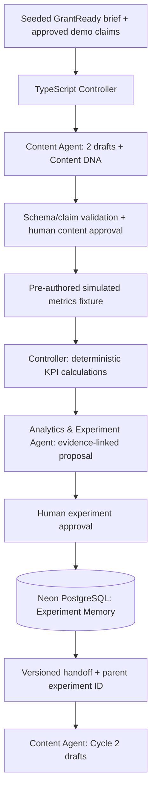

# GrowthLoop AI

**Evidence-Driven Marketing Optimization · Two-Agent, Human-Supervised Demo MVP**  
**Documentation version:** 2.0 · 2026-10-21 · **Project status:** Design / implementation pending. This README does **not** assert the app is built, tested, or deployed.

GrowthLoop AI helps early-stage B2B SaaS marketers learn from messaging experiments: generate two LinkedIn organic draft variants with **Content DNA**, review them, load clearly labeled **pre-authored simulated outcomes**, calculate reliable KPIs, approve a next experiment, persist **Experiment Memory**, and generate Cycle 2 drafts grounded in the saved findings.

**First hypothetical customer:** GrantReady, a proposed nonprofit grant discovery and application-readiness product. GrantReady is the *product being marketed*, not a grant-research feature inside GrowthLoop AI. All demo-only claims must be approved and visibly labeled hypothetical.

## Five-day demonstration scope
- One seeded GrantReady brief, one ICP, one LinkedIn campaign, **two drafts per cycle** (`control`, `variant`).
- **Content Agent:** Anthropic Claude Sonnet generates JSON drafts and Content DNA from approved claims.
- **Analytics & Experiment Agent:** Claude Sonnet reviews controller-computed KPIs and proposes a controlled next test with uncertainty and cited metric IDs.
- **Deterministic TypeScript controller:** all IDs, state transitions, validation, KPI calculations, database writes and approval gates. LLM agents have **no tools or direct DB access**.
- Manual human approvals; no automatic publishing.
- Simulated fixture, provenance, experiment memory persisted in PostgreSQL, two-cycle trace.
- **Cycle 2 ends with new drafts**; no second metrics analysis is required.

**Not in MVP:** CSV upload UI, third variant, UTM export, dashboards, live LinkedIn API, GA4/CRM, multi-workspace/accounts/RBAC, Playwright browser tests, single-agent baseline, causal-lift claims, paid ads, SEO/GEO. See [PRD](PRD.md) for scope and acceptance criteria.

## Workflow


**Truth in demo:** simulated metrics are pre-authored, not caused by the generated drafts; associations do not establish causation or real-world marketing improvement.

## Planned architecture
| Layer | Decision |
|---|---|
| App + API | Next.js App Router, TypeScript Route Handlers / Server Actions |
| UI | React + Tailwind CSS; minimal approval and trace views |
| Runtime agents | Anthropic API, Claude Sonnet; server-side JSON only |
| Controller + contracts | TypeScript state machine + Zod 4 schemas |
| KPI | Pure deterministic TypeScript functions; DB-backed display |
| Persistence | **Neon PostgreSQL in every environment** + Prisma 7; no SQLite |
| Testing | Vitest unit/contract; API-based E2E; explicit real LLM smoke |
| Hosting | Vercel after smoke checks; local demo + video fallback |
| Security | Shared demo access code / platform protection, server-side rate cap, spend limit, secrets server-only |

**Version targets reviewed Oct 21, 2026; verify on install:** Node 24.x; Next 16.4.2; React 19.3.1; TypeScript 5.9.3; Prisma packages 7.10.1; Anthropic SDK 0.137.0; Zod 4.6.7; Tailwind 4.3.3; Vitest 5.0.5. Pin exact versions and commit `package-lock.json`. Verify the selected Anthropic model ID (candidate `claude-sonnet-5-5`) against the actual account. No `latest` dependency guessing.

## Planned repository layout (not yet implemented)
```text
app/                      # App Router pages and API routes
lib/
  agents/content/         # Content Agent prompts and adapter
  agents/analytics/       # Analytics Agent prompts and adapter
  controller/             # state machine, IDs, approvals, handoffs
  kpi/                    # deterministic KPI calculations
  db.ts                   # Prisma / Postgres
  anthropic.ts            # server-only Anthropic client
schemas/                  # Zod source-of-truth contracts
prisma/                   # schema and migrations
data/seed/                # GrantReady claims, brief, ICP, banned phrases
data/fixtures/           # pre-authored simulated metrics and expected KPI
scripts/                  # smoke tests, API E2E, seed
tests/                   # Vitest unit/contract tests
 docs/                    # decisions, actual test report, demo script
CLAUDE.md                 # implementation rules for Claude Code
PRD.md
README.md
TEAM_TASKS.md
PRE_BUILD_CHECKLIST.md
.env.example              # names only, no secrets
```

## Configuration (planned, **not yet executable**)
The implementation must provide a `.env.example` with variable names but **no actual values**:
```dotenv
ANTHROPIC_API_KEY=
ANTHROPIC_MODEL=
DATABASE_URL=              # Neon pooled runtime connection
DATABASE_URL_UNPOOLED=     # Neon direct migration connection
DEMO_ACCESS_CODE=
```
Do not use `NEXT_PUBLIC_ANTHROPIC_*`. No `SESSION_SECRET` is required for this no-login MVP. Do not commit `.env.local`, keys or database URLs. Anthropic client imports `server-only`. In Prisma 7, use explicit driver adapter and `prisma.config.ts`; load `.env.local` intentionally for local CLI if required.

## Planned run and test steps
**These are target commands, not proof that scripts exist today.** Claude Sonnet will create and verify the exact scripts under GL-04/05/11. Intended workflow:
```bash
npm ci
npx prisma generate
npx prisma migrate deploy
npx prisma db seed
npm run dev
npm test
npx tsc --noEmit
npm run build
npm run smoke:llm     # explicit real Anthropic call
npm run smoke:db      # persistence write/restart/read
npm run test:e2e      # explicit API-based two-cycle test
```
Only publish commands in this README as **verified working instructions** after the relevant implementation PR and real run. `npm test` must mock LLM requests and not spend API credits.

## Safety and acceptance
- Claim registry: `approved_demo_claim`, `verified_claim`, `rejected_claim`; unreviewed claims blocked. Every approved demo claim remains explicitly hypothetical.
- Primary KPI: `qualified_demo_requests / landing_page_visits`. Secondary: per-link-click rate, labeled with its denominator. Zero/missing denominator → `not_calculable`.
- Controller assigns stable IDs, stores `metric_id` citations, and blocks unapproved state transitions (409); double-clicks cannot duplicate Cycle 2 drafts.
- Handoff includes schema version, task/correlation/idempotency IDs, parent experiment, metric references and approval state.
- Persist memory in Neon; verify after process restart and redeploy.
- Public demo requires access protection and generation cap; don't expose paid API routes.
- No tests, deployments or results are claimed passing until evidence is recorded in `docs/test-report.md`.

## Five working days (internal targets)
| Day | Date (2026) | Outcome |
|---|---|---|
| D1 | Wed Oct 21 | Team sign-off; GrantReady seed; Anthropic/DB/preview smoke; contracts |
| D2 | Thu Oct 22 | Controller + content approvals + two drafts |
| D3 | Fri Oct 23 | Deterministic metrics + Analytics Agent + Cycle 1 |
| D4 | Mon Oct 26 | Persistent memory + Cycle 2 + E2E; **feature freeze** |
| D5 | Tue Oct 27 | Bugs, verified run instructions, rehearsal, fallback video, submission |

**Owners (proposed until joint approval):** Shawn — architecture, development, deployment and final technical acceptance. Michelle — GrantReady brief/claims/ICP, simulated fixture, independently calculated KPI expectations, content review and demo. Both approve scope and final delivery. Weekend Oct 24–25 is not a working day.

## Documents and issue tracking
- [PRD.md](PRD.md) — product requirements and testable acceptance.
- [TEAM_TASKS.md](TEAM_TASKS.md) — GL-01–GL-12 owner proposals, dependencies and five-day plan.
- [PRE_BUILD_CHECKLIST.md](PRE_BUILD_CHECKLIST.md) — D1 GO/NO-GO and S0–S6 smoke criteria.
- `docs/decisions.md` — **to be created** for joint sign-off.
- `docs/test-report.md` — **to be created** from actual executed tests.

**GitHub status at drafting:** no issues have been confirmed created. `GL-01` etc. are planning IDs, **not GitHub issue numbers**. After joint approval, use authenticated Claude Code / `gh` to create Issues and link them. Update this README after implementation with real installation, environment, test, deployment and demo instructions.


## Fixed operating policy (Shawn decision, 2026-10-21)
- **Primary KPI:** `qualified_demo_requests / landing_page_visits`; **secondary:** `qualified_demo_requests / link_clicks`. Show numerator and denominator. Zero/missing/invalid denominator returns `not_calculable`, never 0. A qualified request is a synthetic fixture count, not inferred by an LLM.
- **Approval responsibility:** Michelle reviews GrantReady claims and content drafts; Shawn approves Analytics Agent experiment proposals and technical release. Both can review final demo. The shared access code does **not** authenticate individual identities; `reviewer` is a selected/recorded demo role, not a verified identity. Never claim enterprise-grade RBAC.
- **Access control:** Protect all private pages and generation/mutation endpoints with a server-validated `DEMO_ACCESS_CODE` delivered outside the public repository. Use a secure server-side session/cookie after code entry (HttpOnly, Secure in production, SameSite=Lax) or a server-validated authorization header for test scripts. Do not rely on UI-only gating. Keep `/api/health` free of sensitive data. Reject unauthenticated requests with 401.
- **Abuse/cost controls:** Maximum **30 successful agent-generation calls per UTC day** across the deployment, enforced atomically in PostgreSQL (not in-memory). Also reject when quota is exhausted (429), configure a **$50 Anthropic workspace spend limit**, and retain SDK timeout/retry safeguards. The spend cap is a backstop, not a substitute for server authorization.
- **Human approvals:** All claims must be approved before use; every content draft and experiment proposal requires an explicit approval action, recorded with role, timestamp, decision, and relevant record ID. Rejected/unapproved records cannot advance.
- **Open external dependencies:** Michelle must confirm the actual GrantReady brief/claims and accept her proposed tasks; the official course deadline/format must be verified. These remain real-world confirmations, not architecture choices.


## Joint Technical Ownership and Development Plan — October 21, 2026

GrowthLoop AI is a collaborative Pursuit Cycle 3 multi-agent project developed by Michelle Sainsbury and Shawn Bi. Both partners have agreed to participate directly in coding, debugging, testing, integration, and understanding the complete application.

This section supersedes earlier proposed responsibility assignments in this README where they conflict. The original architecture, MVP boundaries, security requirements, and acceptance criteria remain in effect unless jointly revised.

### Product Direction

GrowthLoop AI is the application being developed. GrantReady is the hypothetical B2B SaaS product used as the demonstration marketing customer. The MVP does not build GrantReady's grant discovery, matching, eligibility, or application features.

The demonstration uses two specialized AI agents connected through a deterministic TypeScript controller, with human approval gates and persistent Experiment Memory. Marketing performance metrics are pre-authored simulated data, not real campaign outcomes.

### Michelle — Content Agent Technical Lead

Michelle owns implementation of the Content Agent, including:
- Anthropic API integration and prompt development.
- Generation of two structured LinkedIn marketing drafts: control and variant.
- Content DNA output, TypeScript/Zod schema validation, and approved-claim checks.
- Content review and approval interface.
- Unit tests, debugging, and integration with the shared controller.
- Cycle 2 memory-backed content generation in collaboration with Shawn.
- Preparation and review of GrantReady demonstration facts, ICP, approved claims, and marketing examples.

### Shawn — Analytics & Experiment Agent Technical Lead

Shawn owns implementation of the Analytics & Experiment Agent and related components, including:
- Simulated campaign-metrics ingestion and deterministic KPI calculations.
- Anthropic API integration, analytics prompts, and structured experiment proposals.
- Evidence-linked recommendations, uncertainty statements, and one-variable test proposals.
- Experiment proposal review and approval interface.
- Prisma/PostgreSQL persistence and Experiment Memory implementation.
- Unit tests, debugging, and integration with the shared controller.
- Initial application scaffolding and environment smoke tests, with Michelle participating in technical review.

### Shared Engineering Responsibilities

Both partners share responsibility for:
- Architecture reviews and versioned agent handoff contracts.
- TypeScript/Zod schemas, controller integration, state transitions, and failure handling.
- Human approval gates, data provenance, security, and cost controls.
- Feature branches, meaningful commits, pull requests, and mutual code reviews.
- End-to-end testing, debugging, deployment verification, and documentation.
- Demonstrating and explaining the complete two-agent workflow.

### Five-Working-Day Implementation Plan

- Day 1 — Wednesday, October 21: Confirm scope and responsibilities; prepare GrantReady inputs; scaffold infrastructure; review agent contracts and smoke-test results.
- Day 2 — Thursday, October 22: Michelle develops the Content Agent and content approval interface; Shawn develops controller and persistence foundations; both test integration.
- Day 3 — Friday, October 23: Shawn develops KPI processing and the Analytics Agent; Michelle completes Content Agent testing and KPI verification; both integrate Cycle 1.
- Day 4 — Monday, October 26: Both integrate Experiment Memory and Cycle 2 draft generation, test the complete workflow, resolve critical issues, and verify deployment or local fallback.
- Day 5 — Tuesday, October 27: Both complete final testing, documentation, demonstration rehearsals, and joint sign-off.

October 27 is the internal demonstration target; the official Pursuit submission deadline and requirements must be verified.

### Shared Learning Goals

1. Both partners will understand the complete application, not only their individually owned components.
2. Both partners will improve debugging efficiency through systematic reproduction, error analysis, targeted testing, and documented fixes.
3. Both partners will develop greater confidence implementing and integrating AI agents, deterministic application logic, and persistent memory.

### Pursuit PRD and Submission

The GitHub PRD must be collaboratively adapted into Pursuit's official Multi-Agent PRD Google Docs template. The completed document link must be submitted through Pathfinder according to confirmed course requirements.

See PRD.md for product requirements, TEAM_TASKS.md for detailed assignments, and PRE_BUILD_CHECKLIST.md for readiness and verification tasks.

### Current Implementation Status

This section documents the agreed development plan. It does not claim that the application, tests, deployment, GitHub Issues, or official course submission have been completed. Actual progress and test evidence must be recorded as implementation proceeds.
